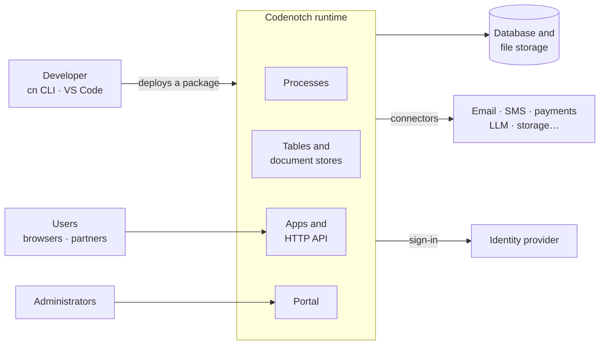

# How Codenotch works

This page explains the main concepts of Codenotch and how they fit together: the runtime,
projects, processes, data, apps, users and deployments. Read it once before you build your
first real project; every concept links to the page that covers it in detail.

## The big picture

A developer writes a project and deploys it to a **runtime**. The runtime runs the
project's processes, keeps its data in a database, serves its apps and its API to users, and
reaches external services through connectors. Administrators manage it all in the portal.
People sign in through an identity provider.

## The runtime

The runtime is the Codenotch server: a single executable that deploys and runs projects. The
same runtime runs everywhere, in two modes:

| | Development | Production |
| --- | --- | --- |
| Where | Your machine, installed by `cn` | A server or a Kubernetes cluster, installed by an operator |
| Database | SQLite, in a local folder | PostgreSQL or SQL Server |
| Sign-in | A development login: one click, no password | Your identity provider (OpenID Connect, Keycloak, FusionAuth) |
| License | A developer license, free | A production license |

Every runtime needs a license. Without one it starts restricted: you can sign in to the
portal and install a license, and nothing else runs.

A production runtime refuses to start with an unsafe configuration, such as the development
login or a missing encryption key. See [Operate](../operate/README.md).

One runtime hosts several projects. They share the runtime's users, its connectors and its
settings, and each project keeps its own data, its own processes and its own address.

## Projects

A project is a folder with a `manifest.json` and TypeScript sources. The manifest names the
project and declares what the code cannot say by itself: its roles, its languages, its
parameters. Everything else is found in the sources: a process is a `process()` call, a
table is a `defineEntity()` call, an app is a React component with an app manifest next to
it. [Tour of a project](../get-started/project-tour.md) shows each file.

A project has two names:

- its **name**, such as `shop`, which identifies it on the runtime;
- its **uri**, such as `shop`, the first segment of its addresses: its apps answer at
  `/shop/<app>/` and its API at `/shop/api/…`.

### From sources to a running project

1. **Compile.** The CLI type-checks your sources, generates what derives from them (the
   database schema, TypeScript types for your tables and parameters, the OpenAPI
   description), bundles your processes and builds your apps.
2. **Package.** The result is one zip file: the package.
3. **Deploy.** The runtime receives the package and checks all of it before changing
   anything: a mistake in one process refuses the whole deployment, with every problem
   listed. When everything is valid, the runtime updates the database, registers the
   processes and serves the new apps. If anything fails, the previous version keeps running.

On your machine, `cn project start` does the three steps at once. See [Deploy your
project](../build/deploy.md).

## Processes

A process is a TypeScript function that the runtime runs for you: `run(ctx, input)`. It
starts on a **trigger**: an HTTP request, a timer, a signal from another process, a change in
a table, a payment event, a person completing a task, an AI agent calling a tool. See [Triggers](../build/processes/triggers.md).

A process is **durable**. The runtime records each step a run takes through `ctx`, the
object the run receives: each read and write, each HTTP call, each email, each wait. If the
runtime stops, the run starts again from the top and gets the recorded answers back instead
of doing each step a second time, until it reaches the point where it stopped. That is why a
process can wait for a month, and why its code must follow one rule: everything that touches
the outside world goes through `ctx`. See [Durable execution](../build/processes/durable-execution.md).

Code that needs Node.js or an npm package runs in an **activity**, which a process calls.
See [Activities](../build/processes/activities.md).

## Data

A project stores its data in:

- **tables**: rows and columns with a schema, declared in TypeScript with `defineEntity()`;
- **document stores**: JSON documents, each of the shape the store declares in TypeScript
  with `defineDocument()`.

The runtime creates them at the first deployment and updates them at every deployment. On
its own, a deployment only adds: new tables, new columns. A rename or a removal is recorded
in the project's **schema history**, and a removal must also be allowed by the deployment.
See [Data](../build/data/README.md).

Processes read and write the data. Apps and other callers read it with the rights of the
person who asks, under the [access policy](../build/data/access-policies.md) of each table.
Queries are written in TypeScript, or in CNQL, the query language of Codenotch.

## Apps and the API

An **app** is a React app the runtime serves at `/<uri>/<app>/`. It starts processes and
reads tables through the `@codenotch/react` library. See [Apps](../build/apps/README.md).

A process that has an HTTP trigger is an **API endpoint** at `/<uri>/api/…`. Once a project
has such endpoints, the runtime serves their OpenAPI description at `/<uri>/openapi`. See
[Your project's API](../build/project-api/README.md).

A process can also be a **tool** for AI agents. Each project serves its own MCP endpoint at
`/<uri>/mcp`: an agent connected to it calls the processes the project declares as tools,
and reads the tables its token may read. See [Expose tools to AI
agents](../build/project-api/agent-tools.md).

The runtime also has its own API, the **platform API**: everything the portal does, a
script or a partner system can do too. See [Platform API](../platform-api/README.md).

## Users and access

The runtime knows two kinds of users:

- **internal** users: your organisation's staff, with roles you define in the project, such
  as `Manager` or `Accountant`;
- **external** users: your customers and partners, signed in but outside your organisation.

Each process, app and table declares who may use it, with one of four **scopes**:

| Scope | Who |
| --- | --- |
| `public` | Anyone, signed in or not |
| `external` | Any signed-in user |
| `internal` | Your organisation's users, optionally only some roles |
| `system` | No person: the platform and other projects' processes |

Machines, such as a partner system or a CI pipeline, use **API tokens**. See [API
tokens](../platform-api/api-tokens.md).

## Parameters and connectors

A project never contains its configuration or its credentials. It declares **parameters**,
such as a welcome message, an API key or a limit, and **connectors**, such as an email
service, a payment provider or an LLM. Whoever deploys the project gives the values in the
portal. The same package runs unchanged on your machine, in a test environment and in
production. See [Parameters](../build/integrations/parameters.md) and
[Connectors](../build/integrations/README.md).

## The portal

Every runtime serves an administration portal at `/portal`. Administrators install
projects, set parameters, register connectors, manage users and API tokens, and follow every
process run step by step. Staff members see the tasks waiting for them. See the [Portal
guide](../portal/README.md).

## Next steps

- [Install the tools](../get-started/install.md) and follow the
  [Quickstart](../get-started/quickstart.md).
- [Glossary](../appendix/glossary.md): every term of Codenotch in one place.
