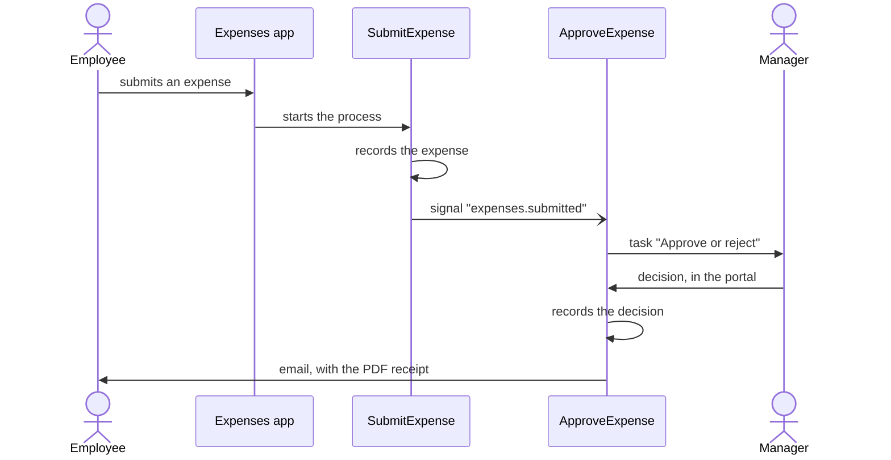

# Tutorial: build an expense approval app

In this tutorial you build a complete Codenotch application, one step at a time. Employees
submit their expenses in a web app. A manager approves or rejects each one in the portal. The
employee then receives an email, with a PDF receipt when the expense is approved. Along the
way you use the main building blocks of Codenotch: a table, processes, a React app, a task
for a person, templates, a connector and tests.

## What you build



- An **app** where employees submit an expense and follow its status.
- A **table**, `Expense`, that stores the expenses.
- Two **processes**: `SubmitExpense` records an expense, and `ApproveExpense` asks a manager
  to decide, then tells the employee.
- A **user task**: the manager's decision form, in the portal.
- An **email** and a **PDF receipt**, rendered from templates.
- **Tests** that check the whole flow in less than a second.

## Before you begin

- Follow the [Quickstart](../get-started/quickstart.md): it installs the tools you need.
- Have Google Chrome or Microsoft Edge on your machine: the local runtime prints PDFs with
  it.
- Plan about an hour.

## The steps

1. [Create the project](create-the-project.md)
2. [Store expenses in a table](store-data.md)
3. [Write your first process](write-a-process.md)
4. [Build the React page](build-the-page.md)
5. [Add an approval step](add-an-approval.md)
6. [Send an email with a PDF](send-an-email.md)
7. [Test your processes](test-the-processes.md)
8. [Deploy to a server](deploy.md)

Each step ends with something you can see working. At the end, your project has these files:

```text
expenses/
├── manifest.json
├── apps/
│   ├── index.tsx
│   └── index.manifest.json
├── tables/
│   └── expense.table.ts
├── processes/
│   ├── submit-expense.process.ts
│   └── approve-expense.process.ts
├── templates/
│   ├── decision.email.tsx
│   └── receipt.pdf.tsx
└── tests/
    └── expenses.test.ts
```

## Next steps

- [Step 1: Create the project](create-the-project.md).
